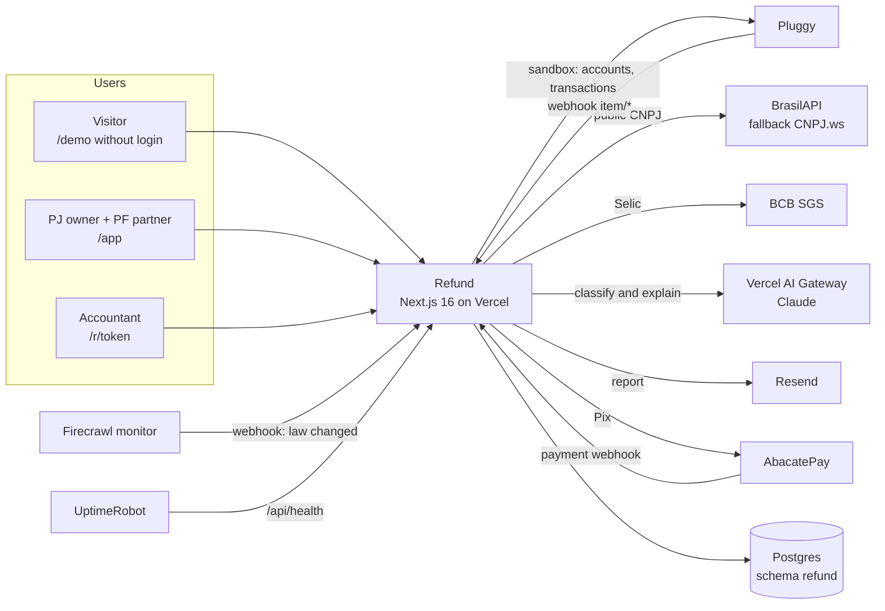

# Refund

> _10 s demo GIF: coming soon._

**The agent that finds the money the government owes you.** Lawful tax savings for individuals and companies in Brazil, with the calculation shown and the law article cited for every cent. The accountant reviews and approves before anything changes.

Built for Hack Brasil 2026, Payments & finance track. The product's interface is in Portuguese.

- **Video (up to 3 min):** _coming soon_
- **Live demo:** _coming soon_
- Versão em português: [README.md](README.md)

## Run in 2 commands

```bash
pnpm install
pnpm dev
```

Open `http://localhost:3000/demo`. No key and no environment variable: the demo runs without `.env`, without a database and without calling any external service.

Requirements: Node 24 and pnpm 12.18. No pnpm 12? Run `corepack enable` first.

## What is real and what is synthetic

|                                           | Real                                                                                                                                 | Synthetic / test                                                                                                                |
| ----------------------------------------- | ------------------------------------------------------------------------------------------------------------------------------------ | ------------------------------------------------------------------------------------------------------------------------------- |
| Calculation engine                        | The same code in `/demo` and `/app`, with the step-by-step calculation                                                               | —                                                                                                                               |
| Laws and tables                           | Rates, brackets and limits from official sources, with the source recorded in the code                                               | —                                                                                                                               |
| Transaction classification                | Deterministic rules; the AI only handles the leftovers and never applies directly what moves a value                                 | —                                                                                                                               |
| Person, company and statements in `/demo` | —                                                                                                                                    | Made up; the persona's CNPJ does not exist at the Receita Federal                                                               |
| Bank accounts in `/app`                   | —                                                                                                                                    | Pluggy sandbox only: the widget lists test banks only, and a real bank connected anyway is deleted at once, with no data copied |
| CNPJ typed in `/app`                      | Looked up in public registries (BrasilAPI, falling back to CNPJ.ws)                                                                  | —                                                                                                                               |
| Pace of the `/demo` analysis screen       | The analysis really runs every time                                                                                                  | Only the interval between steps is controlled, to give time to read                                                             |
| AI                                        | In `/app`, when configured: classifies what the rules did not resolve and writes the explanation from the calculation, behind guards | In `/demo` the AI is off: explanations are templates filled with the engine's numbers                                           |

The AI never calculates and never picks a law article: every value comes from the engine, and every citation comes from the rule itself.

## Architecture



pnpm + Turborepo monorepo:

| Package            | What it does                                                                             |
| ------------------ | ---------------------------------------------------------------------------------------- |
| `apps/web`         | The Next.js 16 app (App Router, Node runtime)                                            |
| `@refund/engine`   | Pure tax engine: no network, database, AI or clock; money in integer cents               |
| `@refund/law`      | Corpus of the laws and articles cited                                                    |
| `@refund/sources`  | External sources (Pluggy, CNPJ, Selic) with live and replay modes, and a field whitelist |
| `@refund/pipeline` | Normalizes, classifies, builds the facts and runs the engine; no I/O                     |
| `@refund/ai`       | Classification and explanation behind numeric and citation guards; template fallback     |
| `@refund/personas` | Synthetic personas                                                                       |
| `@refund/db`       | Postgres schema (Drizzle) and repositories                                               |

## Classification accuracy

Measured by `packages/pipeline/test/accuracy.test.ts` against the answer key of the demo persona (174 transactions):

| Criterion                                                                                              | Target                                            | Measured        |
| ------------------------------------------------------------------------------------------------------ | ------------------------------------------------- | --------------- |
| Transactions applied directly, without a question (98)                                                 | ≥ 98% right                                       | 100% (98 of 98) |
| Transactions that become a question to the user (76)                                                   | right suggestion, never applied before the answer | 76 of 76        |
| After the persona's answers: all 174 transactions (including those above R$ 1.000 that feed a finding) | 0 errors                                          | 0 errors        |

**Caveat:** we wrote both the persona and the answer key, and the classification rules were built looking at that set. The answers used are the answer key's. The number measures consistency, not accuracy on real bank statements. On this persona the rules classify everything; the AI classified no transaction. The second planned set, at least 300 noisy Pluggy sandbox transactions labeled by hand, **has not been measured yet**.

## Tests

```bash
pnpm lint && pnpm typecheck && pnpm deps && pnpm test && pnpm test:golden && pnpm guard
pnpm e2e --project=demo-chromium
```

`pnpm test:golden` runs each rule's reference cases, the checks against official examples (PGDAS-D manual, the Lei 15.270 examples, the Receita's IR simulator table), property tests with random inputs and the invariants of the full analysis (the sum of the savings equals the total, to the cent). The current counts are on the `/motor` page, generated by `node scripts/generate-engine-page.ts`.

## Architecture decisions (ADRs)

- ADR-002: The engine is pure and the AI does not calculate
- ADR-004: `/demo` without a database, with zero variables, and data embedded in the build
- ADR-005: Providers with live/replay mode and a whitelist at ingestion
- ADR-013: "Law changed" writes to the database and never changes a parameter on its own
- ADR-016: Explanations use slots; the model writes no digits and no citations

## License

MIT. See [LICENSE](LICENSE).
