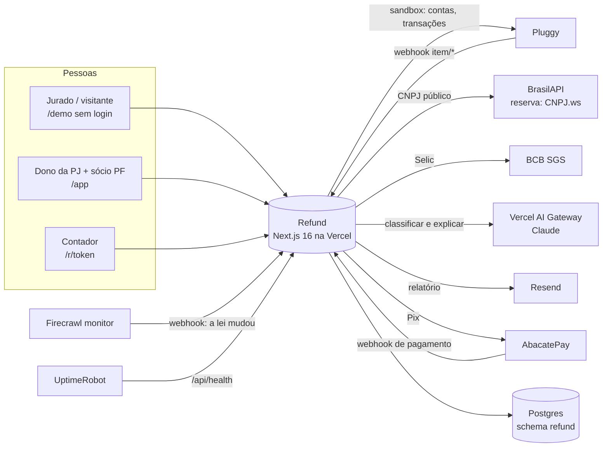

# Refund

<!-- TODO(E21): GIF de 10 s da demo aqui (gerado do vídeo final). -->
> _GIF de 10 s da demonstração: entra com o vídeo (etapa E21)._

**O agente que acha o dinheiro que o governo te deve.** Economia tributária lícita para pessoa física e empresa, com a conta aberta e o artigo da lei citado em cada centavo. O contador revisa e aprova antes de qualquer mudança.

Feito para o Hack Brasil 2026, trilha Pagamentos & finanças.

- **Vídeo (até 3 min):** _link em breve_ <!-- TODO(E21): link do vídeo no YouTube (não listado) -->
- **Demo no ar:** _link em breve_ <!-- TODO(E22): URL de produção/demo -->
- English version: [README.en.md](README.en.md)

## Rode em 2 comandos

```bash
pnpm install
pnpm dev
```

Abra `http://localhost:3000/demo`. Nenhuma chave e nenhuma variável de ambiente: a demonstração roda sem `.env`, sem banco de dados e sem chamar nenhum serviço externo.

Requisitos: Node 24 e pnpm 12.18.

## O que é real e o que é de teste

|                                       | Real                                                                                                                               | De teste                                                                                             |
| ------------------------------------- | ---------------------------------------------------------------------------------------------------------------------------------- | ---------------------------------------------------------------------------------------------------- |
| Motor de cálculo                      | O mesmo código em `/demo` e em `/app`, com a conta passo a passo                                                                   | —                                                                                                    |
| Leis e tabelas                        | Alíquotas, faixas e limites de fontes oficiais, com a fonte registrada no código                                                   | —                                                                                                    |
| Classificação das transações          | Regras determinísticas; a IA só entra no que sobra, e nunca aplica direto o que mexe num valor                                     | —                                                                                                    |
| Pessoa, empresa e extratos da `/demo` | —                                                                                                                                  | Inventados; o CNPJ da persona não existe na Receita                                                  |
| Contas bancárias em `/app`            | —                                                                                                                                  | Só o sandbox (ambiente de teste) da Pluggy; nenhum banco real é conectado                            |
| CNPJ digitado em `/app`               | Consultado em bases públicas (BrasilAPI e, se falhar, CNPJ.ws)                                                                     | —                                                                                                    |
| Ritmo da tela de análise da `/demo`   | A análise roda de verdade a cada vez                                                                                               | Só o intervalo entre os passos é controlado, para dar tempo de ler                                   |
| IA                                    | No `/app`, quando configurada: classifica o que as regras não resolveram e escreve a explicação a partir da conta, atrás de travas | Na `/demo` a IA fica desligada: as explicações são textos-modelo preenchidos com os números do motor |

A IA nunca faz conta e nunca escolhe artigo de lei: todo valor sai do motor, e toda citação vem da própria regra.

## Arquitetura



Monorepo pnpm + Turborepo:

| Pacote             | O que faz                                                                                      |
| ------------------ | ---------------------------------------------------------------------------------------------- |
| `apps/web`         | O app Next.js 16 (App Router, runtime Node)                                                    |
| `@refund/engine`   | Motor tributário puro: sem rede, sem banco, sem IA, sem relógio; dinheiro em centavos inteiros |
| `@refund/law`      | Acervo de leis e artigos citados                                                               |
| `@refund/sources`  | Fontes externas (Pluggy, CNPJ, Selic) com modo ao vivo e replay, e lista de campos permitidos  |
| `@refund/pipeline` | Normaliza, classifica, monta os fatos e roda o motor; sem I/O                                  |
| `@refund/ai`       | Classificação e explicação com travas numéricas e de citação; texto-modelo de reserva          |
| `@refund/personas` | Personas sintéticas                                                                            |
| `@refund/db`       | Esquema Postgres (Drizzle) e repositórios                                                      |

## Precisão da classificação

Medida pelo teste `packages/pipeline/test/accuracy.test.ts` contra o gabarito da persona da demonstração (174 transações):

| Critério (ENGINE-SPEC E.8)                                                 | Meta                                             | Medido          |
| -------------------------------------------------------------------------- | ------------------------------------------------ | --------------- |
| Transações que entram direto, sem pergunta (98)                            | ≥ 98% certas                                     | 100% (98 de 98) |
| Transações que viram pergunta para o usuário (76)                          | sugestão certa, nunca aplicada antes da resposta | 76 de 76        |
| Depois das respostas: transações acima de R$ 1.000 que alimentam um achado | 0 erro                                           | 0 erro          |

**Ressalva:** a persona e o gabarito foram escritos por nós, e as regras de classificação foram feitas olhando esse conjunto. O número mede consistência, não a precisão com extratos reais. Nesta persona as regras classificam tudo; a IA não classificou nenhuma transação. O segundo conjunto previsto, com pelo menos 300 transações ruidosas do sandbox da Pluggy rotuladas à mão, **ainda não foi medido**.

## Testes

```bash
pnpm lint && pnpm typecheck && pnpm deps && pnpm test && pnpm test:golden && pnpm guard
pnpm e2e --project=demo-chromium
```

`pnpm test:golden` roda os casos de referência de cada regra, a conferência com exemplos oficiais (manual do PGDAS-D, exemplos da Lei 15.270, tabela do simulador de IR da Receita), propriedades com entradas aleatórias e as invariantes da análise completa (a soma das economias é igual ao total, ao centavo). As contagens atuais estão na página `/motor`, gerada por `node scripts/generate-engine-page.ts`.

## Decisões de arquitetura (ADRs)

1. Monorepo com pacotes internos e sem etapa de build
2. O motor é puro e a IA não calcula
3. Cenário combinado com contribuição marginal
4. `/demo` sem banco, com zero variáveis e dados embutidos no build
5. Fontes com modo ao vivo/replay e lista de campos permitidos na entrada
6. Postgres portátil com schema `refund`; Supabase só como hospedagem; PGlite em dev e testes
7. Tempo real via SSE com eventos persistidos
8. Sessão anônima própria; WorkOS só quando configurado
9. Direitos do plano no servidor com cota atômica; Pix avulso libera um período
10. Webhooks verificados por provedor e idempotentes por tabela
11. Observabilidade enxuta com keep-alive embutido
12. Reserva automática do Open Finance por capacidade
13. "A lei mudou" grava no banco e nunca muda um parâmetro sozinha
14. CSP estática sem nonce
15. TypeScript 6.0.3, Biome e dependency-cruiser
16. Explicações usam lacunas; o modelo não escreve dígitos nem citações

## Licença

MIT. Veja [LICENSE](LICENSE).
